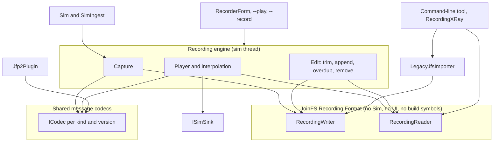

# Recorder v2 — design space and proposal

**Status: proposal, nothing implemented.** Written against `main` at `2f44e5c` (2026-10-02).
Builds on `docs/recording-protocol.md` (the audit of today's `.jfs` format),
`docs/reference/jfp2-protocol.md` and `docs/reference/joinfs-architecture.md`.

## 1. Summary

- **What a recording becomes:** a time-ordered log of *canonical messages*
  (`IdentityUpdate`, `PositionUpdate`, `VariableSyncUpdate`, `EventUpdate`, ...) on *tracks*, in a
  chunked, self-describing container. Format name **JFS2**, file extension `.jfs2`.
- **How it is encoded:** by the same per-kind, per-version codecs JFP2 uses. The recorder stops
  being a third serializer.
- **What it buys:** unknown content is skipped instead of desyncing the file; recording streams to
  disk and survives a crash; jumping restores state; new things to record (weather, markers, chat,
  flight plans) are a new record kind, not a format change.
- **Old files:** playing existing `.jfs` recordings is a requirement. One isolated importer module
  does it, reachable from File → Open and from a small command-line tool (§8). The app does not
  write `.jfs` any more.

## 2. What is wrong today

`docs/recording-protocol.md` §7–§8 lists the format-level problems: no magic, no framing, no
checksum, EOF-sensing, a `#if FS2024` that changes the byte layout, duplicated readers that disagree.
Reading `Recorder.cs` adds problems that are about the *shape* of the design, which patching the
format (length prefixes, a magic number) would not fix:

| Problem | Where | Consequence |
|---|---|---|
| The whole recording lives in memory as one heap object per frame, and reaches disk only on Save | `Obj.frames`, `MainForm.SaveRecording` | A crash or a forgotten Save loses the session; memory grows with length |
| The file is object-major: all frames of object 1, then all of object 2 | `Recorder.Write` | Cannot be written while recording; cannot be read without loading everything |
| Jump scans from frame 0 and re-applies only the last position | `Recorder.Jump` | Variable frames before the target are skipped, so object state after a jump is whatever happened to be applied before |
| Identity is written once per object | `Obj.Write` | A model or livery change during the recording cannot be represented |
| The file says nothing about itself | — | No date, simulator, app version, title; variables are bare `vuid` hashes, so `RecordingXRay` re-parses `Variables.cs` to name them |
| A third serializer | `JfsFrames`, `Sim.Write/Read` | The canonical model and the JFP2 codecs already describe the same data; `registration`, `flightNumber`, `classCode`, `wtc` exist there and are lost here |
| Format code compiled per simulator | `#if FS2024` in `Obj.Write` | The §7.1 bug class stays possible as long as format code sees build symbols |

## 3. Principles

The constraints taken from *The Pragmatic Programmer*, and what each one decides here:

| Principle | Decision |
|---|---|
| DRY — one authoritative representation | One codec per (message kind, version), shared by JFP2 and the recorder. `RecordingXRay` uses the format library instead of its own reader |
| Orthogonality | Three layers that do not know each other's business: container (bytes, chunks, index), codecs (message ↔ bytes), engine (capture, playback, editing) |
| Easier to change; no final decisions | Compression, chunk size, keyframe interval and the set of record kinds are data in the file or writer policy, never the layout itself |
| Don't program by coincidence | Nothing is inferred from "bytes remain". Every block and record states its length |
| Crash early | Magic, per-block CRC and bounds checks: a damaged file fails at the damaged block with a clear message, and the rest plays |
| The power of plain text | The binary file has a lossless text dump (`dump` → JSON Lines → `undump`). Metadata is UTF-8 key/value. Variable names are stored |
| Tracer bullets | The first deliverable records and replays one aircraft end to end through every layer (§9), before any layer is complete |
| Don't live with broken windows | The §7.1 and §7.2 bugs are removed with the code path, not patched |
| Good-enough software | BCL only. No columnar encoding, no quantisation, until a measurement asks for it |
| Test ruthlessly | Golden files per codec version, round-trip property tests, truncation and corruption fuzzing of the reader, a corpus of real old `.jfs` files for the importer |

## 4. The design space

### 4.1 Container

| Option | For | Against | Verdict |
|---|---|---|---|
| **A. Patch `.jfs`** (magic, length prefixes; recording-protocol.md §8.3) | Smallest change | Still object-major, in memory, no seek; old readers break anyway | No — pays the compatibility cost without the benefits |
| **B. Own chunked log** (PNG/RIFF-like blocks, index at the end) | Streams, skips, seeks; ~500 lines; no dependency; exactly our vocabulary | We own the spec | **Recommended** |
| **C. MCAP** (the robotics log container: channels, schemas, chunks, index, attachments) | Same shape as B, already specified; third-party viewers | I know of no first-party .NET library, so we would implement the spec ourselves; nanosecond clocks and pub/sub concepts we don't need | Best prior art: borrow its structure for B. Adopt only if a maintained .NET library exists |
| **D. SQLite file** | Transactions, trivial editing and querying, tooling everywhere | Native dependency in every variant and in the Linux hub; payloads are still blobs needing codecs; heavier writes | Good second choice if editing becomes the main use |
| **E. ZIP package** (`manifest.json` + one stream per track) | Self-describing, standard tools | Not appendable, not crash-safe, per-entry compression defeats seeking | No |
| **F. Text** (JSON Lines) | Readable, diffable, scriptable | 5–10× the size, slow at 20 Hz × N aircraft | As dump/export format, not as the primary |
| **G. Capture datagrams** (pcapng of JFP2) | No new format at all | Records envelopes, peer ids and negotiation state; cannot hold our own aircraft or legacy peers | No — but its core idea survives in §4.3 |

### 4.2 Organisation

*Object-major* (today) versus *time-major* (records of all objects interleaved in time order, cut
into chunks). Time-major is what makes streaming, crash safety and bounded memory possible, and an
index gives back random access. Recommended.

### 4.3 What a record is

1. *Sim structs* (today): `Sim.AircraftPosition`, three variable dictionaries. Tied to `Sim.cs`.
2. *Wire datagrams* (option G).
3. ***Canonical messages*** — the protocol-independent structs in `JoinFS/Net/Messages`. This is
   the level the architecture already treats as the truth: `SimMessageMapper` converts to and from
   Sim types, the session layer consumes them, and they are a superset by design. **Recommended.**
   The recorder becomes, in effect, a peer that listens (capture) and a peer that speaks (playback).

### 4.4 How a record is encoded

| Option | Note | Verdict |
|---|---|---|
| Reuse the JFP2 codecs (`ICodec<T>`) | One serializer, one set of golden tests; a quantised `PositionV2` would benefit both. Cost: `PositionV1` repeats `ObjectId` and `NetTime` (12 of 103 bytes) that the record header already carries | **Recommended** |
| Recorder-specific codecs | Free to optimise for storage | A second serializer to keep in step — the situation we are leaving |
| Protobuf / MessagePack / CBOR | Field-level evolution for free | A second evolution mechanism next to "one codec per version", plus a dependency |

One difference from the network has to be designed for: JFP2 negotiates, so a sender never uses a
codec the receiver lacks. A file was written once and cannot adapt. A build that lacks a decoder
skips those records (§5.6), which degrades gracefully for peripheral kinds such as weather or notes,
but a file whose `position` or `identity` version can no longer be decoded does not play at all.
**So only the newest encoder is used, and decoders are kept by default. Retiring one is a
deliberate decision per kind, made only after the `convert` tool can re-encode old files to the
current version.**

### 4.5 Smaller axes

| Axis | Options | Choice |
|---|---|---|
| Time | f64 seconds (today); integer ticks | i64 microseconds since recording start, stored per record as a varint delta from the chunk start. UTC start time in the header |
| Integrity | none; per record; per block | CRC-32 per block |
| Compression | none; Deflate or Brotli (both in the BCL); Zstd/LZ4 (packages) | Per chunk, identified by a byte. Start with none; add Deflate when measured |
| Seeking | scan; index; index + state snapshots | Chunk index plus periodic keyframes (§5.4) |
| Editing | in place; edit list; rewrite | Rewrite to a new file, streaming, then atomic rename |

## 5. Proposed format: JFS2

### 5.1 Model

- **Track**: one recorded object for one stretch of its life. It has a file-local id, an open and a
  close, and identity records that may change in between.
- **Record**: one canonical message on one track at one time.
- **Chunk**: a few seconds of records from all tracks, independently decodable.
- **Keyframe**: a chunk that also carries the full state needed to start playing from it.

### 5.2 Layout

All integers little-endian. Everything at the top level is a block, so everything can be skipped.

```
File    := Magic(8)  Block*  Footer
Block   := Type:u8  Length:u32  Body[Length]  Crc32:u32

Header  (type 1)  FormatMajor:u8  FormatMinor:u8
                  RequiredFeatures:u32  OptionalFeatures:u32
                  StartUtc:i64  Metadata: (key, value) UTF-8 pairs
Schema  (type 2)  KindId:varint  Name:string  Version:u8          e.g. (3, "position", 1)
Chunk   (type 3)  TMin:i64  TMax:i64  Flags:u8 (keyframe)  Compression:u8
                  SnapshotCount:u32  RecordCount:u32  Records...
Index   (type 4)  per chunk: offset, TMin, TMax, flags
                  per track: id, first/last time, callsign, model
Attach  (type 5)  Name:string  MediaType:string  Bytes            e.g. variable names, thumbnail
Footer            IndexOffset:u64  Crc32:u32  Magic(8)            fixed size, at end of file

Record  := Kind:varint  Track:varint  TimeDelta:varint  Length:varint  Body[Length]
```

- **Magic** `FA 00 'J' 'F' 'S' '2' 0D 0A`. Its first two bytes read as the int16 `250`, so a build
  from before this change that is handed the file rejects it through its existing
  `version < 10022` check instead of misparsing it. The CR LF catches text-mode transfer damage.
- **Schema blocks** bind a file-local kind id to a name and a codec version. They can appear
  anywhere before first use. Two versions of the same message in one file are simply two kind ids,
  which is what lets recordings from different builds be appended without re-encoding.
- **Feature flags**: a reader must refuse a file with a `RequiredFeatures` bit it does not know,
  and must ignore unknown `OptionalFeatures` bits. This is how a container-level change ships
  without a new major version.

### 5.3 Record kinds for the first version

| Kind | Body | Replaces in `.jfs` |
|---|---|---|
| `track-open` | owner kind (me / network / recorder), nickname, source app + simulator. Written when the object starts being recorded, at any point in the recording | `Aircraft.Nickname`, object ordering |
| `identity` | `IdentityV1Codec` | `Plane`, `Callsign`, `Model`, `TypeRole`, `Livery`, `IcaoType`, `IcaoAirline` — plus registration, flight number, class code, WTC, which `.jfs` drops |
| `position` | `PositionV1Codec` | `AircraftPositionFrame` |
| `object-position` | new `ObjectPositionV1Codec` (JFP2 does not carry this kind today) | `ObjectPositionFrame` |
| `variables` | `VariableSyncV1Codec` | the three `*VariablesFrame` types; one code path for every object, which removes §7.2 |
| `event` | `EventV1Codec` | `SimEventFrame` |
| `track-close` | empty. Written when the object leaves, is unflagged, or recording stops | implicit end of the frame list |

Candidates that become cheap afterwards, each one a new kind and nothing else: `flight-plan`,
`weather` (METAR, so playback can restore conditions), `note` (chat), `marker` (a named point to
jump to), `sim-time`, and diagnostic kinds such as "position as received, with receive time" for
replaying real traffic into the position estimator.

Capture is an allowlist, in two ways. Only kinds with a record kind defined here are written:
everything else the network delivers (mesh, peer info and ATC status, hub directory, status
requests) never reaches the recorder, and a message class added to JFP2 later is not recorded until
someone adds a kind for it. And only objects flagged for recording get a track, as today.

### 5.4 Keyframes and seeking

A keyframe chunk starts with a snapshot section (`SnapshotCount` records): for every open track,
its `track-open`, current `identity` and the full current variable set. Linear playback skips the
snapshot section; a jump finds the last keyframe at or before the target through the index, applies
the snapshot, then replays records up to the target. Events are edge-triggered and are not replayed
during a seek, as today. Chunk length (about 2 s) and keyframe interval (about 10 s) are writer
policy and can change without touching readers.

### 5.5 Streaming and crash safety

- While recording, the sim thread encodes into a pooled chunk buffer with no per-record allocation
  and hands full chunks to a writer thread. Disk never blocks the sim thread.
- The file on disk is valid after every chunk. Index and footer are written on stop. A file without
  them (crash, power loss) is repaired by scanning block headers, and loses at most the last chunk.
- Playback reads chunk by chunk, so memory is bounded by chunk size, not by recording length.

### 5.6 The extension contract

1. Unknown block type: skip by length.
2. Unknown kind name or version (newer than this build, or retired from it): skip those records,
   play the rest, and tell the user how many were skipped. If the skipped kind is one playback
   cannot do without (`track-open`, `identity`, `position`, `object-position`), say so and point to
   `convert` instead of playing an empty scene.
3. A new field is a new codec version of that kind. A shipped codec is never edited.
4. Decoders are kept by default and pinned by golden files; retiring one follows §4.4. Encoders
   exist only for the newest version.
5. Kind names, block types and feature bits are never reused.
6. The format and codec assemblies are compiled without simulator symbols, so a `#if FS2024` in
   format code is impossible by construction, not by discipline.
7. `FormatMajor` changes only if the block structure itself changes.

### 5.7 Size

At 20 Hz, ten aircraft produce 720,000 position records per hour. Today that is 100 bytes per frame,
about 72 MB; with `PositionV1` and a 7-byte record header it is about 79 MB before compression. So
size is roughly unchanged at first. The options, in order of effort: Deflate per chunk; a recording
rate below 20 Hz, since playback already interpolates; the quantised `PositionV2` that JFP2
specifies but has not implemented. Measure before choosing.

## 6. Module architecture



- **Format library**: blocks, chunks, CRC, index, repair. It sees a record as (kind, track, time,
  bytes) and has no idea what a position is. Usable by the app, the hub, the tools and the tests.
- **Shared codecs**: the existing `Codecs/` move out from under `Jfp2/` into a neutral namespace
  that both the JFP2 plugin and the recorder depend on. Neither depends on the other.
- **Engine**: capture takes canonical messages (network objects already arrive that way in
  `MainSessionHost`; local objects go through `SimMessageMapper`). Playback decodes them and feeds
  the same sink network ingestion uses, with owner *Recorder*. It depends on `ISimSink` and
  `IClock`, not on `Main`. Interpolation stays here and is not a format concern.
- **Importer**: the only code that knows the old format (§8).

## 7. Today's features on the new design

| Feature | How |
|---|---|
| Record, stop, save | Streams to a working file from the first second; Save finalises and moves it |
| Play, pause, loop | Chunk-by-chunk read against the recorder clock |
| Jump | Index + keyframe (§5.4), with state restored |
| Trim start / end | Streaming rewrite of the kept range, starting at a keyframe |
| Append | Copy the second file's chunks with a time offset and remapped track and kind ids; no payload re-encoding |
| Overdub | Record new tracks while playing; on stop, merge both into one time-ordered file |
| Remove an object | Rewrite without that track |
| `--play`, `--record` | Unchanged for the user |

## 8. Old recordings

**Requirement: every `.jfs` recording the current release can play must still play.**

**Decision: do not carry the old format inside the new one, and do not make users run a converter
either. Write one importer and give it two front doors. There is no "Save as legacy `.jfs`".**

- `LegacyJfsImporter` reads a `.jfs` and emits canonical messages into a `RecordingWriter`. It is
  the old reader, frozen, isolated, and covered by a corpus of real files.
- **Door 1 — File → Open.** The app looks at the first bytes: JFS2 magic → new reader; otherwise
  → importer, then play. Users keep opening their old files as before.
- **Door 2 — a small command-line tool** (`convert`, `dump`, `verify`, `repair`) for batch
  conversion and inspection, built on the same libraries. `convert` also re-encodes a `.jfs2` to
  current codec versions (§4.4). `RecordingXRay` moves onto them too.
- The app **never writes** the old format, and the new engine never reads it directly.

Why this split rather than native backwards compatibility:

- The old format has nothing to hang compatibility on: no magic, no framing. A format that old
  builds can still read is, by definition, the old format with its limits.
- The old format is ambiguous in a way only an offline pass can resolve. At the same version, an
  `FS2024` build writes three trailing strings per object and every other build writes two
  (recording-protocol.md §7.1), and nothing in the file says which. An importer can parse both ways
  and accept the one that passes validation (plausible frame types, counts and coordinates, and
  ending exactly at end of file), and report when neither or both do. A playback path should never
  contain that kind of guesswork; a one-time conversion can, and afterwards the ambiguity is gone.
- Compatibility code attracts changes. Kept behind an importer interface it is write-once, and the
  day it can be deleted, one module goes and nothing else moves.

What the importer maps (every persisted `.jfs` field has a home):

| `.jfs` | JFS2 |
|---|---|
| `Aircraft`: `Plane`, `Callsign`, `Model`, `TypeRole`, `Livery`, `IcaoType`, `IcaoAirline` | `identity` (IsAircraft, IsPlane, ...); fields the old file lacks stay empty |
| `Aircraft.Nickname` | `track-open` |
| `Obj`: `Model`, `TypeRole`, tail strings | `identity` with IsAircraft = false |
| Frame `Time` (f64 seconds) | record time (microseconds) |
| `AircraftPositionFrame` | `position`; ground flags → `StateFlags`; `StaticCgToGround` stays NaN when absent |
| `ObjectPositionFrame` | `object-position` |
| `SimEventFrame` | `event` |
| Integer / Float / String8 variable frames | `variables`, one entry per value with its kind |

Two points to confirm against real files:

- **Frames on plain objects (§7.2).** The writer wrote those frames completely; only the in-app
  reader lacks the cases. An importer with the full switch should read files the current app
  misreads, which is better than recording-protocol.md §7.2 concludes.
- **The eight reserved frame types** have no length and no known layout. If one ever appears, the
  importer has to stop with a clear error.

Transition:

- New recordings are saved as `.jfs2` only. The Open dialog lists both `.jfs2` and `.jfs`; the Save
  dialog lists `.jfs2`. `--play` accepts either.
- An opened `.jfs` is converted in memory and played. Saving it afterwards writes a `.jfs2` next to
  it; the original is never modified.
- A `.jfs2` cannot be opened by older builds. People who share recordings need to be on a build
  that has the new recorder.
- Acceptance test for the importer: for every file in the corpus that the current release reads
  correctly, the imported recording has the same objects, the same number of frames per object and
  type, and the same values as the current `Recorder.Parse` produces on the build variant that
  wrote the file. Files the current release misreads (§7.1 across variants, §7.2) are checked by
  hand.

## 9. Delivery in tracer bullets

1. **Corpus first.** Collect real `.jfs` files from each build variant, including overdubbed and
   appended ones. They are the importer's tests and the only evidence about §7.1 in the wild.
2. **Tracer bullet.** Format library with writer, reader and `dump`; kinds `track-open`, `identity`,
   `position`. Record your own aircraft, play it back in the simulator. No index, no compression.
3. **Widen.** Remaining kinds, keyframes, index, jump. Truncation and corruption tests on the reader.
4. **Importer** with corpus tests; open-by-magic in the app; the command-line tool.
5. **Editing** on the new engine, then delete the old write code and `RecordingXRay`'s reader. The
   old read code is not deleted: it moves into the importer.
6. **Measured options**: compression, recording rate, `PositionV2`, new kinds.

Each step leaves a working recorder; the old one stays in place until step 5.

## 10. Open questions

1. Accept the 12 redundant bytes in `PositionV1` for the sake of one codec, or wait for `PositionV2`?
2. Should JFP2 adopt the new `object-position` codec, so non-aircraft objects leave the legacy wire?
3. Overdub: merge on stop (proposed), or let chunks overlap in time and merge in the player?
4. Which metadata is worth capturing by default (session name, pilots, airport, weather)?

## 11. Decisions

| Date | Decision |
|---|---|
| 2026-10-02 | Format name JFS2, extension `.jfs2` |
| 2026-10-02 | Old `.jfs` recordings must remain playable, through the importer |
| 2026-10-02 | No "Save as legacy `.jfs`"; the app writes `.jfs2` only |
| 2026-10-12 | Format spec edition 1 approved with its ten decisions (`format-spec.md` Appendix C): signed delta times; times and ids in bodies not authoritative; the snapshot holds the latest position; `variables` records are upserts; first chunk is a keyframe and the Index is a rebuildable cache; file-local kind ids with recorder-private lifecycle kinds; no feature bits yet; a damaged chunk stops non-keyframe playback until the next keyframe; `variable-names.txt` attachment; edit by writing a new file and renaming. Open question 1 (keep the 12 redundant bytes) is settled by item 2; questions 2, 3 and 4 stay open |
| 2026-10-12 | Project layout: the format library is a standalone project, `JoinFS.Recording.Format`, with no reference to JoinFS. The messages and codecs become a shared library as a separate prep refactor before stage 2 |
